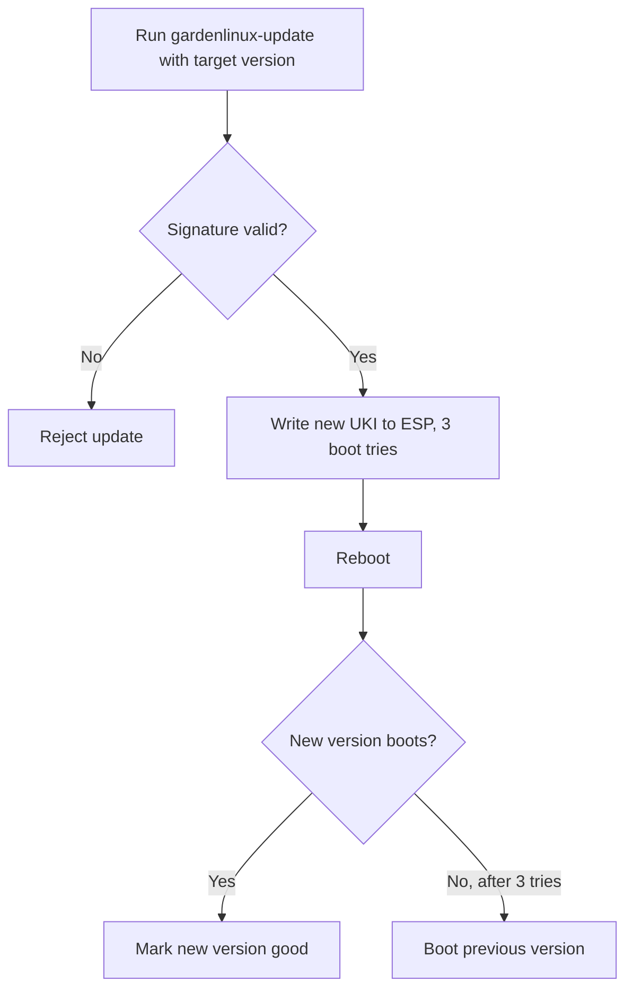

# In-Place Updates

An in-place update atomically updates an existing deployment of a Garden Linux
image to a new version. It moves a deployed instance from the image version it was
deployed with to a newer one.

In-place updates are a property of the
[USI boot mode](/explanation/boot-modes#unified-system-image-usi), where the whole
operating system is a single signed, immutable image. That design is what makes the
update atomic, and it also means the running system is read-only by default (see
[Immutability and the read-only root](#immutability-and-the-read-only-root)).

In-place updates are the only officially supported way to change the version of a
deployed instance. The alternative is to swap the root disk for one holding the new
image, which on most hyperscalers means creating a new instance.

Incremental, Debian-style package changes (`apt install`, `apt upgrade`) are
explicitly **not** supported and do not work by default. The root filesystem is
read-only, and an image's APT sources are pinned to the frozen package snapshot of
the exact version it was built from, so there are no newer packages to upgrade to.
A user could change the APT sources and remove the protections that keep the root
filesystem read-only, but the result is an unsupported and likely inconsistent
state.

:::warning In-place does not mean live
"In-place" refers to updating the existing instance rather than replacing the node,
not to updating it without downtime. An in-place update **always requires a reboot**
to activate the new version. It is not a live update and does not keep the node in
operation while it runs.
:::

## How atomicity is achieved

An in-place update is all-or-nothing. The new version is delivered as a single
[Unified System Image (USI)](/reference/glossary#usi-unified-system-image) — one
signed image containing the whole operating system — so the instance either boots
the complete new version or stays on the complete old one. There is no partially
upgraded state in between, which keeps the installation consistent and coherent
across the update.

The update is also safe to attempt: the previous version is kept on disk, and if
the new version fails to boot the instance **automatically rolls back** to it (see
[Automatic rollback](#automatic-rollback)). A failed update therefore returns the
instance to its previous working version rather than leaving it broken.

### Compared to A/B boot

If you know A/B boot schemes, the behavior is familiar: a new version is written
alongside the current one, and the bootloader falls back to the known-good version
if the new one fails. Garden Linux provides the same guarantees with a leaner
on-disk layout.

A classic A/B scheme pre-allocates two fixed partition slots, and a verified-boot
variant adds a dm-verity data and hash partition per slot, resulting in a total of
four pre-allocated fixed-size partitions that must each be sized large enough to
accommodate any future update. Garden Linux needs none of that. Each version is a
single image file on the EFI System Partition, so slots are not pre-allocated — disk
usage scales with the number of versions present, not with a fixed reservation. The
same mechanism also allows more than two versions to be kept at once, making this
effectively an unlimited A/B/C/… scheme, though in practice more than two versions
are rarely needed.

Integrity protection comes for free from the same design. With Secure Boot enabled,
one signature over the Unified Kernel Image covers the entire operating system,
including the root filesystem embedded in it. There is no separate dm-verity
partition to allocate or maintain — another reduction in disk footprint. See
[Secure Boot and Trusted Boot](/explanation/secure-boot) for the full trust chain.

### Immutability and the read-only root

USI images are immutable by design: the operating system is a single signed image,
and the root filesystem is mounted read-only. Only a few writable areas, chiefly
`/var` and an overlay on `/etc`, are initialized on first boot. This is a property
of every image that supports in-place updates.

A consequence is that package-manager operations that modify the system, such as
`apt install`, are not supported on a USI deployment. Software and configuration are
baked into the image at build time; changes are delivered by updating to a new image
version, not by mutating the running one.

## Requirements

In-place updates are only available in
[USI boot mode](/explanation/boot-modes#unified-system-image-usi), which requires
UEFI. [Legacy](/explanation/boot-modes#legacy-boot-mode) (BIOS) images cannot be
updated in place.[^legacy]

[^legacy]: Not yet, at least. Legacy support is currently under investigation and may be supported in future releases.

:::warning Version requirement
Updates across a minor or major version require a **target** version that resets
`/etc` on upgrade (see [Updating across versions](#updating-across-versions)). This
is the case from **2150.13.0** on the 2150 line, and from **1877.27** on the 1877
line. Only the target version matters, not the version you update from.
:::

## When to use in-place updates

The default way to update a node is to replace it: provision a new machine on the
new version, move the workload over, and discard the old machine. In-place updates
are the alternative for cases where keeping the exact same machine is worth more
than the simplicity of replacing it.

The question to ask is whether the specific machine has value that a fresh
replacement would lose. Common reasons:

- **Node-local storage bound to the machine.** A machine with directly attached
  storage, such as a local NVMe device, holds data that cannot be re-attached to a
  replacement. Unlike a network-attached volume, that storage does not follow the
  workload to a new machine, so replacing the machine means losing or migrating the
  data.
- **Physical machines.** On bare-metal or on-premises installations there is no API
  to discard a machine and create a new one. The machine is a physical box, so
  updating it in place is the only practical path.
- **Scarce instance types.** When a workload needs an instance type with limited
  availability, giving up the machine during an update is a gamble: the provider may
  not have that type in stock when the replacement is requested, and another tenant
  may take the freed capacity in the meantime. Keeping the machine avoids that risk.

These are examples of the same principle, not an exhaustive list: use in-place
updates whenever retaining the running machine across the update is the goal.

:::info
On [Gardener](https://gardener.cloud)-managed clusters, in-place updates are driven
by the worker pool update strategy rather than run by hand. See
[Garden Linux on Gardener](#garden-linux-on-gardener), and Gardener's
[Introducing In-Place Updates in Gardener](https://gardener.cloud/blog/2025/05/05-19-enhanced-node-management-introducing-in-place-updates-in-gardener/)
for the feature from the Gardener side.
:::

## How it works

In USI boot mode the entire operating system — kernel, initrd, and the
[EROFS](/reference/glossary#erofs-enhanced-read-only-file-system) root filesystem —
is a single
[Unified Kernel Image (UKI)](/reference/glossary#uki-unified-kernel-image) stored on
the [EFI System Partition (ESP)](/reference/glossary#efi-system-partition-esp).
Updating the operating system therefore means placing a new UKI on the ESP and
booting it. For the full boot-mode background, see
[Boot Modes](/explanation/boot-modes#unified-system-image-usi).

The `gardenlinux-update` tool performs the update:

1. It reads the current flavor and version from `/etc/os-release` and confirms the
   machine is booted via UEFI from a Garden Linux UKI. It refuses to run otherwise.
2. It resolves the requested version against the Garden Linux image registry
   (`ghcr.io/gardenlinux/gardenlinux` by default) to find the matching UKI.
3. It verifies the image signature against the Garden Linux signing key that is
   built into every image at `/etc/gardenlinux/oci_signing_key.pem`. An image that
   fails verification is rejected. See
   [Secure Boot and Trusted Boot](/explanation/secure-boot) for how image signing
   fits into the wider trust chain.
4. It downloads the new UKI and writes it onto the ESP alongside the current one. If
   the ESP lacks free space, it first removes older UKIs, never the running version.

The tool does not reboot the machine and does not decide which version to move to;
the caller supplies the target version and triggers the reboot. On the next boot the
firmware loads the new UKI.

### Automatic rollback

Each new UKI is written with a boot counter of three tries. The bootloader
decrements the counter on every boot attempt. If the new version boots
successfully, the system marks it as good and the counter is removed. If it fails to
boot three times, the bootloader marks the entry as bad and falls back to the
previous version, which is still present on the ESP. No operator action is needed
for this fallback.

The bootloader always boots the newest version on the ESP that is not marked bad.
Rollback is therefore a return to the immediately previous version, reached by
marking the newest entry bad — not a free choice of version.

:::info
Boot counting detects failures that happen during boot. A system that boots but is
unhealthy at the application layer is not caught by this mechanism.
:::

### Updating across versions

A USI image mounts a writable overlay on `/etc` backed by the `/var` partition. The
behavior of that overlay across an update depends on the version being booted.

From **2150.13.0** (2150 line) and **1877.27** (1877 line), the image resets the
`/etc` overlay whenever the booted version differs from the version that last wrote
the overlay. The reset restores `/etc` to the image default, preserves
`/etc/machine-id` so the machine keeps its identity, and runs the configured
`/etc` setup hooks so first-boot configuration is reapplied on the new version. This
reset is what makes updates across major versions safe; without it, only upgrades
across minor versions could be supported, because the new image starts from its own
`/etc` rather than inheriting potentially incompatible configuration from the old
one. The reset runs on any version change, including minor updates: it is not
strictly required for a minor update, but applying it consistently means even a
minor release can change configuration defaults — for example to update
containerd — without risking compatibility issues with the old `/etc`.

Because the reset is performed by the image being booted into, only the target
version needs to support it. Updating from an older version to a target at or above
these versions resets `/etc` as described.

:::warning
An in-place update across versions resets `/etc`. Configuration written to `/etc` at
runtime is discarded; only `/etc/machine-id` is preserved. Persist configuration
through an `/etc` setup hook, or keep it on the `/var` partition, rather than
relying on runtime edits to `/etc` surviving an update.
:::

Earlier versions keep the `/etc` overlay across updates instead of resetting it.
With that behavior an update is only safe when the old and new configuration stay
compatible, which in practice limits it to updates within a minor version.

Persistent data outside `/etc` is governed by the `/var`
[storage mode](/explanation/boot-modes#mutable-data-modes), not by the update:
[`_nocrypt`](/reference/features/_nocrypt) and
[`_tpm2`](/reference/features/_tpm2) keep `/var` across reboots, while
[`_ephemeral`](/reference/features/_ephemeral) starts from an empty `/var` on every
boot.

### /etc setup hooks

Because the `/etc` reset discards runtime changes to `/etc`, any configuration that
must survive an update is reapplied by `/etc` setup hooks. These hooks are the
supported interface for re-provisioning `/etc` after a reset.

A hook is an executable file placed in `/var/lib/gardenlinux/etc-setup-hooks/`. This
directory lives on the `/var` partition, so hooks persist across the reset.
Requirements:

- A hook must be a **regular file** and **executable**. Entries that are not
  executable are skipped.
- Hooks run in filename order. Prefix names with a number (for example
  `10-configure-network`) to control ordering.
- A hook should be reproducible: running it across multiple updates should always
  produce the same `/etc` configuration. For example, when it creates users it
  should assign fixed UIDs rather than auto-selected ones, so identities stay stable
  from one update to the next.

The hooks run on a boot where the `/etc` overlay was reset, after the reset and
before the system reaches its normal multi-user state. A boot that does not reset
`/etc` (an unchanged version) does not run them.

:::tip
Install the hooks at deployment time — for example from a cloud-init user-data
script — so they are already present on the `/var` partition before the first
update resets `/etc`.
:::

## What is supported

- **Minor and major upgrades**, provided the target version resets `/etc` (see
  [Updating across versions](#updating-across-versions)).
- **Automatic rollback** to the previous version when a new version fails to boot.
- **UEFI machines in USI boot mode.** Legacy (BIOS) images are not supported.

### Downgrades

The only downgrade is a return to the immediately previous version, through the
rollback mechanism described in [Automatic rollback](#automatic-rollback). Today
this happens automatically when a new version fails to boot. A manual rollback
trigger that marks the current version bad — behaving as if the boot check had
failed — is planned.

Selecting an arbitrary older version and rolling back to it is not supported and is
out of scope. The bootloader always boots the newest version on the ESP that is not
marked bad, so there is no mechanism to pin an older version.

## Garden Linux on Gardener

[Gardener](https://gardener.cloud) is the primary consumer of Garden Linux in-place
updates. It uses them for its in-place node update strategies, where a worker node's
operating system is updated without replacing the node. Gardener orchestrates
draining the node, running the update, and verifying the result; on Garden Linux
nodes the update step calls `gardenlinux-update` and reboots.

Which versions a node may update to in place, and how the update is triggered, are
configured on the Gardener side. See the Gardener documentation on
[Shoot updates](https://gardener.cloud/docs/gardener/shoot_updates/) for the worker
pool update strategies and version constraints.

## Related topics

<RelatedTopics />
